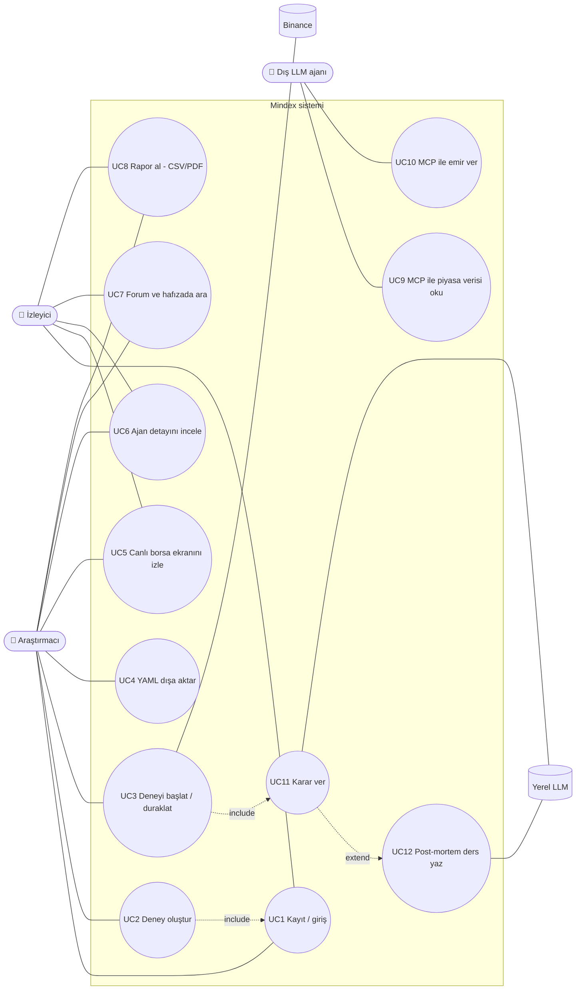

# 1. Use Case Modeli

## Aktörler

| Aktör | Tür | Açıklama |
|---|---|---|
| Araştırmacı | Birincil, insan | Deney kurar, başlatır/durdurur, rapor alır (F1 rolü `researcher`) |
| İzleyici | Birincil, insan | Yalnızca canlı ekranı, ajan detayını, forumu ve raporları görür (F1 rolü `viewer`) |
| Dış LLM ajanı | Birincil, sistem | MCP sunucusu üzerinden arenaya katılır (F9) |
| Binance | İkincil, sistem | Geçmiş OHLCV (REST) ve canlı fiyat (WebSocket) sağlar |
| Yerel LLM (llama.cpp) | İkincil, sistem | Qwen3.5-9B ile karar ve post-mortem üretir |
| Zamanlayıcı | İkincil, sistem | Gün sonu tetiklemesi, canlı modda periyodik karar döngüsü |

## Diyagram

## Use case tanımları

| ID | Ad | Aktör | Ön koşul | Ana akış | Alternatif / hata akışı | İster |
|---|---|---|---|---|---|---|
| UC1 | Kayıt / giriş | Araştırmacı, İzleyici | — | E-posta + parola → JWT | Hatalı parola → 401, 5 denemede hız sınırı (429) | F1, NF3 |
| UC2 | Deney oluştur | Araştırmacı | Giriş yapılmış, rol `researcher` | Varlık, dönem, ajan seti, koşul (C0–C3), seed, komisyon seç → kaydet | Test dönemi doğrulama penceresiyle çakışırsa uyarı; geçersiz form → alan hatası | F2 |
| UC3 | Deneyi başlat / duraklat | Araştırmacı | Deney `draft` veya `paused` | Kuyruğa (Redis Streams) yazılır → işçi simülasyonu yürütür | İşçi çökerse checkpoint'ten devam | F3, F4, NF2 |
| UC4 | YAML dışa aktar | Araştırmacı | Deney mevcut | Yapılandırma YAML olarak indirilir | — | F2, NF5 |
| UC5 | Canlı ekranı izle | Herkes | Deney `running` | Mum grafiği, işlem işaretleri, lider tablosu WebSocket ile akar | Bağlantı kopar → istemci otomatik yeniden bağlanır | F5, NF1 |
| UC6 | Ajan detayı | Herkes | — | Portföy geçmişi, karar gerekçesi, kullanılan anılar, forum mesajları, güven skorları | — | F6 |
| UC7 | Forum / hafıza ara | Herkes | — | Mesaj akışı, güven grafiği; dersleri rejime göre filtrele, hibrit arama | — | F7 |
| UC8 | Rapor al | Herkes | Deney `completed` | Sharpe, MDD, getiri, sürü korelasyonu; koşul karşılaştırma; CSV/PDF | — | F8 |
| UC9–10 | MCP araçları | Dış LLM ajanı | MCP token'ı | `get_market_data`, `get_portfolio`, `place_order` | Başka ajanın portföyüne erişim → 403 | F9, NF3 |
| UC11 | Karar ver | Zamanlayıcı → LLM ajanı | Gün kapanışı | Gözlem → hafıza → forum → JSON karar | Bozuk JSON → 2 yeniden deneme → pozisyonu koru | NF2 |
| UC12 | Post-mortem | LLM ajanı | Pozisyon kapandı | Karşı-olgusal PnL tablosu → ders → tutarlılık kontrolü → pgvector | Tabloyla çelişen ders reddedilir | — |
