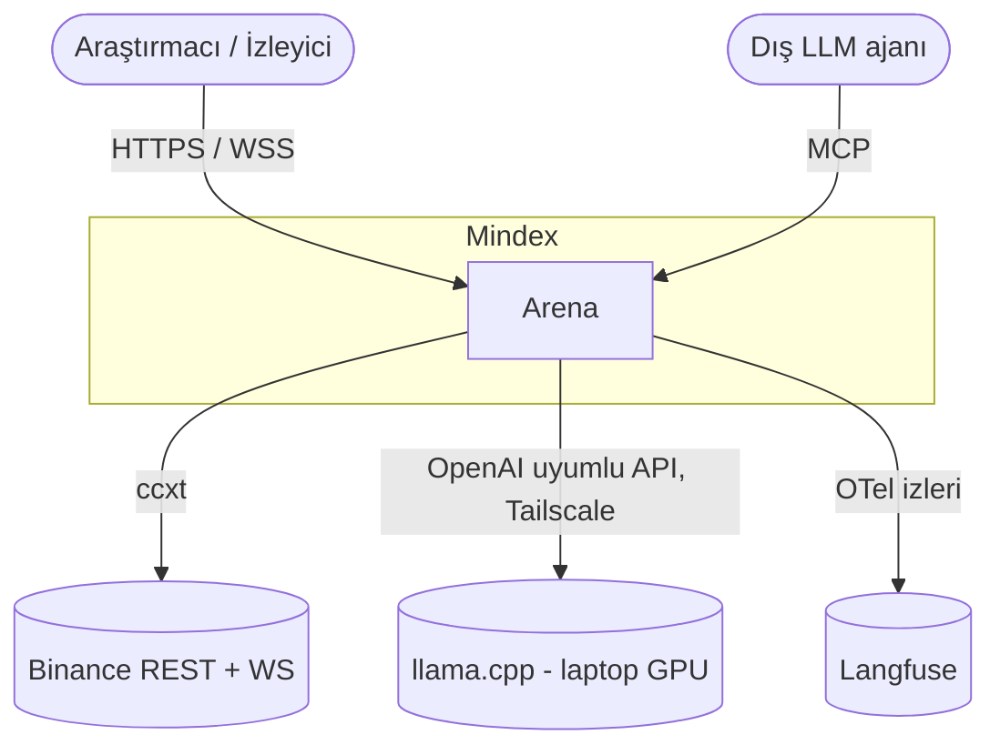
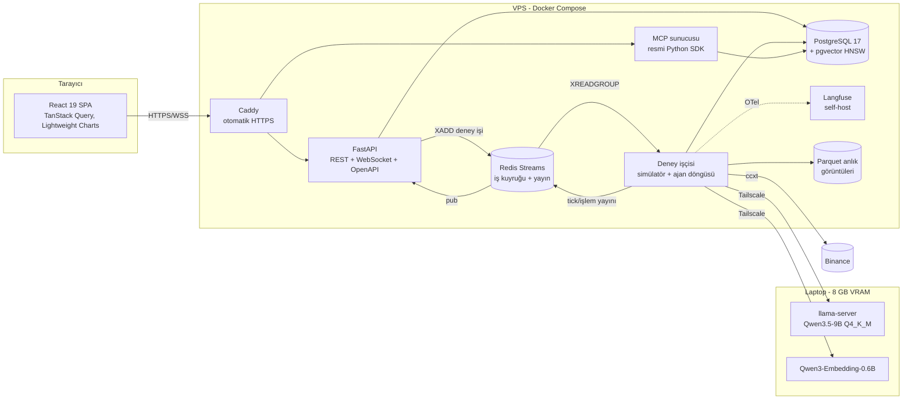

# 2. Sistem Mimarisi

Mindex dört katmandan oluşur: **Veri**, **Simülatör**, **Ajanlar**, **Sunum/Protokol**. Uzun süren deneyler API sürecinden ayrı bir işçide (worker) koşar; LLM çıkarımı GPU'lu dizüstüne Tailscale tüneliyle bağlanır.

## Bağlam (C4 seviye 1)

## Konteynerler (C4 seviye 2)

## Katmanlar

| Katman | Sorumluluk | Ana bileşenler |
|---|---|---|
| Veri | OHLCV, Fear & Greed, funding rate çekme; Parquet anlık görüntüleri; train/val/test ayrımı | ccxt, Polars, DuckDB |
| Simülatör | `t` kapanışında karar, `t+1` açılışında %0,1 komisyon + 5 bp kayma ile yürütme; long-only, kaldıraçsız; checkpoint | Saf Python, Gymnasium ortamı |
| Ajanlar | `BaseAgent` arayüzü; kural tabanlı (3), PPO (1), LLM (4); hafıza, forum, post-mortem | PydanticAI, Stable-Baselines3, hmmlearn, pgvector |
| Sunum / Protokol | REST, WebSocket, MCP; kimlik doğrulama; rapor | FastAPI, MCP SDK, React |

## Temel tasarım kararları (ADR özeti)

| # | Karar | Gerekçe | Alternatif |
|---|---|---|---|
| ADR-1 | Tek PostgreSQL'de ilişkisel + vektör veri (pgvector) | Tek yedek, tek işlem sınırı, JOIN ile hibrit arama | Ayrı vektör DB (Qdrant) — operasyon yükü |
| ADR-2 | Deney işçisi API'den ayrı, Redis Streams ile | Uzun deneyler HTTP isteğini bloklamaz; consumer group ile yeniden deneme | Celery — daha ağır |
| ADR-3 | Yerel LLM (llama.cpp), bulut yok | Maliyet sıfır, veri egemenliği, birebir tekrarlanabilirlik | Bulut API — look-ahead ve maliyet riski |
| ADR-4 | Karar adımında düşünme modu kapalı + JSON şeması ile kısıtlı üretim | p95 < 10 sn hedefi, bozuk JSON riskini azaltır | Serbest metin + regex — kırılgan |
| ADR-5 | Prototip MSW ile sahte API'ye bağlı | Aynı frontend kodu gerçek API'ye geçer; sözleşme önce tanımlanır | Statik HTML mock — atılır |
| ADR-6 | Forum mesajları güvenilmeyen veri | OWASP LLM01 prompt injection | — |
