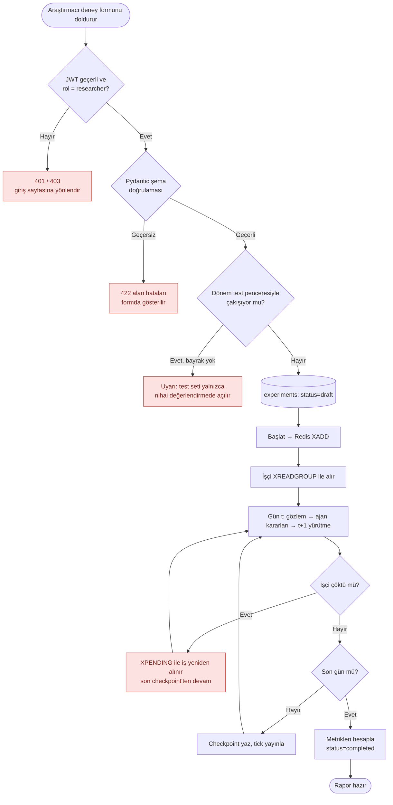
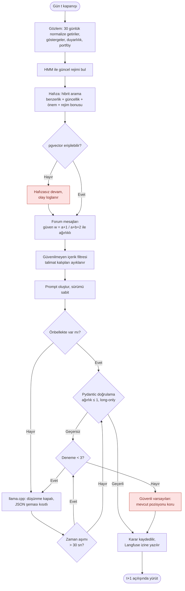
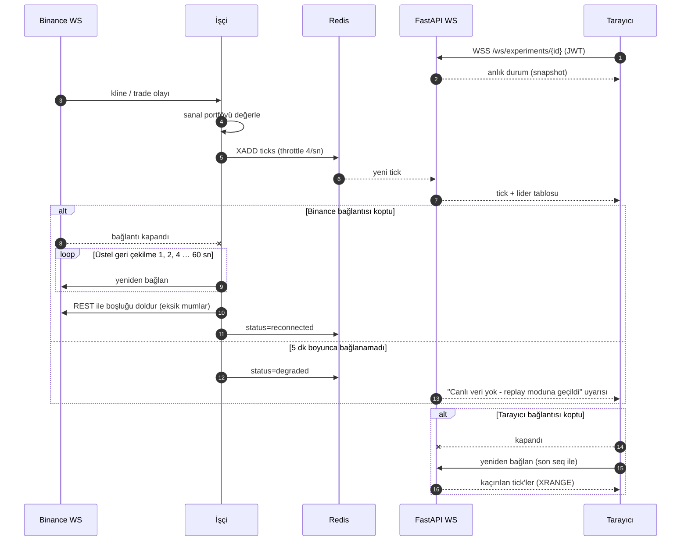

# 3. Akış Diyagramları (hata dallarıyla)

Üç kritik akış: (1) deney oluşturma ve yürütme, (2) LLM ajan karar döngüsü, (3) canlı paper-trading veri akışı. Kırmızı düğümler hata dallarıdır.

## Akış 1 — Deney oluşturma ve yürütme (F2, F3, NF2)

## Akış 2 — LLM ajan karar döngüsü (NF2, NF3)

Bu akışın doğrulama/yeniden deneme kısmı [`backend/src/mindex/domain/decision.py`](../backend/src/mindex/domain/decision.py) içinde uygulanmış ve test edilmiştir.

## Akış 3 — Canlı paper-trading veri akışı (F4, F5, NF1)

