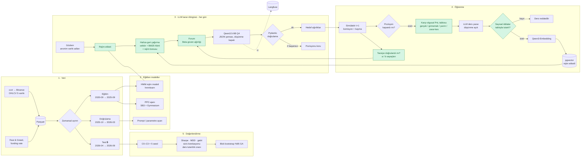

# 4. AI Pipeline

Yeşil düğümler projenin özgün bileşenleridir: karşı-olgusal post-mortem, rejim farkındalıklı hafıza, güven tabanlı forum.

## Look-ahead bias protokolü

1. Test dönemi (Nisan–Eylül 2026) model yayımından (2 Mart 2026) sonradır.
2. Test verisi yalnızca nihai değerlendirmede açılır; CI'da test Parquet'i okunursa hata verilir.
3. Prompt'larda varlık adları (`ASSET_A`…) ve tarihler (`gün 0…N`) anonimleştirilir.
4. Kasım–Aralık 2026 canlı paper-trading hiç görülmemiş veride ileri testtir.

## Deney koşulları (ablasyon)

| Koşul | Kişisel hafıza | Forum | Güven ağırlığı |
|---|:-:|:-:|:-:|
| C0 | — | — | — |
| C1 | ✔ | — | — |
| C1′ (rejimsiz) | ✔ (rejim bonusu yok) | — | — |
| C2 | ✔ | ✔ | eşit |
| C3 | ✔ | ✔ | Beta |
