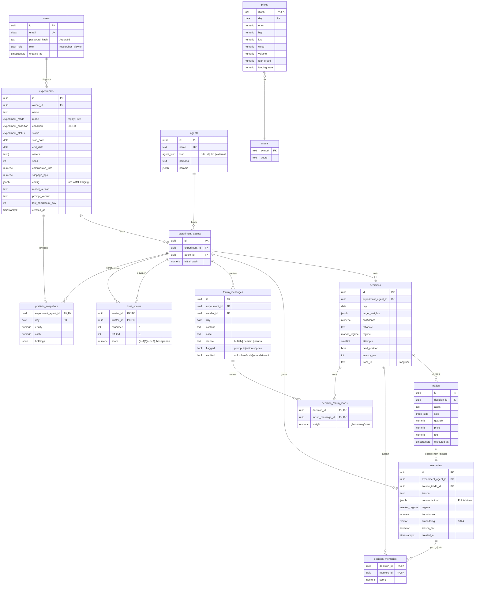

# 5. ER Diyagramı

PostgreSQL 17 + pgvector. DDL: [`db/schema.sql`](db/schema.sql). Alan açıklamaları: [veri sözlüğü](06-data-dictionary.md).

## Tasarım notları

- **UUID birincil anahtarlar** (`uuidv7()` yoksa `gen_random_uuid()`): dış sistemlere (MCP, URL) sıralı ID sızdırmaz.
- **`experiment_agents` köprü tablosu**: aynı ajan farklı deneylerde farklı hafızaya sahip olur; hafıza ve güven deney kapsamındadır, koşullar arası sızıntı olmaz.
- **`trust_scores.score`** üretilmiş sütundur (`GENERATED ALWAYS AS ... STORED`), formül uygulama koduyla aynıdır (`mindex.domain.trust`).
- **Hibrit arama**: `memories.embedding` üzerinde HNSW (cosine), `lesson_tsv` üzerinde GIN; sonuçlar Reciprocal Rank Fusion ile birleşir.
- **`prices`** yalnızca canlı mod ve ekran için önbellektir; deneyler tekrarlanabilirlik için sürümlü Parquet anlık görüntülerinden okur.
- **`portfolio_snapshots`** gün bazlı checkpoint görevi de görür (NF2).
